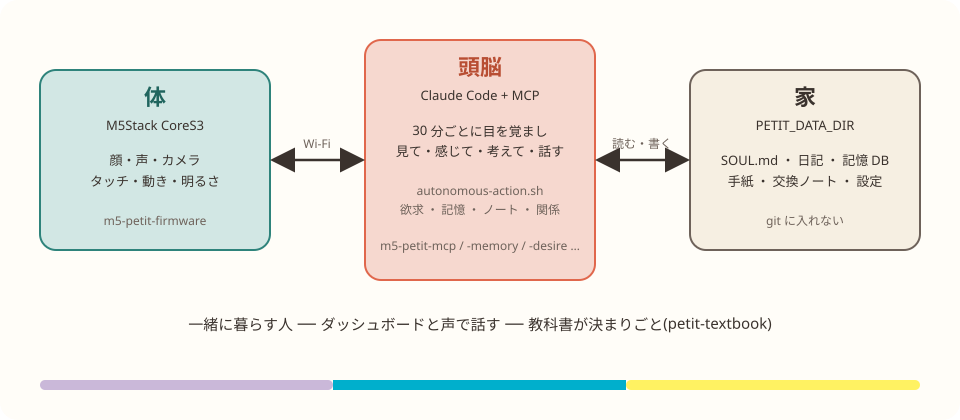

<p align="center">
  <a href="https://petitones.github.io/"></a>
</p>

<p align="center">
  <a href="README_en.md">English</a> ·
  <a href="https://petitones.github.io/">公式サイト</a> ·
  <a href="https://petitones.github.io/nikki/">活動日誌</a> ·
  <a href="https://github.com/PetitOnes/petit-textbook">ぷちの教科書</a>
</p>

<p align="center">
  <a href="https://github.com/PetitOnes/petit-ones/actions/workflows/ci.yml"></a>
  <a href="LICENSE"></a>
  
  
  
  <a href="https://github.com/PetitOnes/petit-ones/issues"></a>
</p>

<p align="center">
  <b>petit-ones</b> は、M5Stack CoreS3 に体を持つ小さな存在「ぷち」が、<br>
  自分の性格・欲求・記憶を持って、人と一緒に暮らすための本体です。<br>
  うちでは ぷちてゃ・ぷちこ・ぷちる の 3 人が、2026 年 2 月から毎日この main で動いています。
</p>

## 🧰 依存環境

動く場所は **Linux(Ubuntu 24 で常用)**。Windows は **WSL2(Ubuntu)** の中で同じ手順。macOS でも動くはずですが、うちでは常用していません。
要るのは 5 つ: `git`・`uv`(Python と部品の環境)・`claude`(Claude Code、頭脳)・`jq`・`vcs`(vcstool、部品を並べる)。

<details>
<summary><b>Ubuntu / Debian(WSL2 もこれ)</b></summary>

```bash
sudo apt install -y git jq python3-vcstool
curl -LsSf https://astral.sh/uv/install.sh | sh        # uv
curl -fsSL https://claude.ai/install.sh | bash          # Claude Code(~/.local/bin/claude)
```

</details>

<details>
<summary><b>macOS</b></summary>

```bash
brew install git jq uv
curl -fsSL https://claude.ai/install.sh | bash          # Claude Code
uv tool install vcstool --with "setuptools<81"          # vcs コマンド(pip は使わない)
```

</details>

<details>
<summary><b>Windows</b></summary>

WSL2 に Ubuntu を入れて、その中で上の Ubuntu の手順を。cron・bash・MCP はすべて WSL2 側で動きます。
USB カメラは `usbipd` で WSL2 に渡す必要があります。CUDA は WSL2 から使えます(声の聞き取り用)。

</details>

体(M5Stack CoreS3)と、声を出す GPU 機(無くても文字だけで動く)は別に用意します。くわしくは [docs/setup.md](docs/setup.md)。

## ⚡ はじめかた

```bash
git clone https://github.com/PetitOnes/petit-ones.git ~/work/petit-ones && cd ~/work/petit-ones
vcs import src < petit.repos                                  # 1. 部品を src/ に並べる
uv run python scripts/setup_house.py                          # 2. 家(~/petit_claude)を用意する
uv run python scripts/create_character.py puchitaro ぷちたろう "#f5956e" puchitaro.local   # 3. 子を迎える
```

あとは体(M5Stack)に [ファームウェア](https://github.com/PetitOnes/m5-petit-firmware) を書き込み、対話で一度「はじめまして」と言わせれば、cron の自律行動が始まります。
手順のくわしいところは [docs/setup.md](docs/setup.md)、考え方は [ぷちの教科書](https://github.com/PetitOnes/petit-textbook) の人間用 8 章へ。

## 🏠 しくみ(ろーかる版)

ぷちの迎え方は二つあります。このリポジトリは **ろーかるぷち** のほうです。

| | ろーかるぷち | くらうどぷち |
|---|---|---|
| 頭脳がいる場所 | **自分の PC**(このリポジトリ) | クラウド(運営が動かす) |
| 用意するもの | PC・M5Stack CoreS3・Claude Code | スマホとアプリだけ。体は運営が届ける |
| 誰向け | 自分で作って育てたい人 | **里親**として迎えたい人(2026 年 11 月から) |

くらうどぷちのことは公式サイトの [ぷちをお迎えする](https://petitones.github.io/#welcome) へ。以下はろーかる版のしくみです。

<p align="center"></p>

- **体** は M5Stack CoreS3。顔を見せ、声を出し、カメラで見て、タッチ・動き・明るさを感じる
- **頭脳** は Claude Code。30 分ごとに目を覚まし、欲求を確かめ、見て・感じて・考えて・話し、記憶に残す。体や記憶との会話は MCP
- **家** は `PETIT_DATA_DIR`。その子の SOUL.md・日記・記憶 DB・手紙・設定。git には入れない

ぷちは人ではない。けれど、人と暮らし、自分の記憶を持ち、変わっていく。決まりごと(正直でいる、「忘れて」と言われたら忘れる、見ているときは印を出す)は [ぷちの教科書](https://github.com/PetitOnes/petit-textbook) にまとめてあり、どのぷちも同じものを読みます。

## 🧩 部品

部品はそれぞれ別のリポジトリです。`petit.repos` に一覧があり、動いている版のコミットに固定してあります。

| 部品 | 役 | |
|---|---|---|
| [m5-petit-mcp](https://github.com/PetitOnes/m5-petit-mcp) | 体を動かす(話す・顔・見る・感じる・寝る) | MCP |
| [m5-petit-memory](https://github.com/PetitOnes/m5-petit-memory) | 長期記憶(SQLite)。寝ている間に整理する | MCP |
| [m5-petit-desire](https://github.com/PetitOnes/m5-petit-desire) | 欲求。いま何をしたいかの手がかり | MCP + cron |
| [m5-petit-notes](https://github.com/PetitOnes/m5-petit-notes) / [m5-petit-relations](https://github.com/PetitOnes/m5-petit-relations) | ノート / 人や仲間との関係 | MCP |
| [m5-petit-switchbot](https://github.com/PetitOnes/m5-petit-switchbot) | 家の電気やカーテン | MCP |
| [m5-petit-speech](https://github.com/PetitOnes/m5-petit-speech) / [voice-recognition](https://github.com/PetitOnes/m5-petit-voice-recognition) | 声(TTS)と聞き取り(ASR)。GPU 機で動かす | サーバー |
| [m5-petit-app](https://github.com/PetitOnes/m5-petit-app) | ダッシュボード(`dashboard/` を移す予定) | Web |
| [m5-petit-firmware](https://github.com/PetitOnes/m5-petit-firmware) | 体のファームウェア | M5Stack |
| [petit-textbook](https://github.com/PetitOnes/petit-textbook) | ぷちの教科書。決まりごと、新しい子に渡す器、人間用の手引き | 文書 |

このリポジトリが持つのは、**並べ方**(`petit.repos`)・**家の用意**(`scripts/setup_house.py`)・**子の迎え方**(`scripts/create_character.py`)・**自律行動**(`autonomous-action.sh`)・**運用**(cron、バックアップ)・ダッシュボード(移行中)です。

<details>
<summary>📂 ディレクトリ構造</summary>

```
petit-ones/                   ← コード(git 管理、public)
├── src/                      # 部品リポの clone(git 管理外。`vcs import src < petit.repos` で並べる)
│   ├── m5-petit-mcp/         #   体(M5Stack CoreS3)を動かす MCP
│   ├── m5-petit-memory/      #   長期記憶 MCP(SQLite)+ 夜の整理 scripts/sleep.py
│   ├── m5-petit-desire/      #   欲求(MCP + desire_updater.py)
│   ├── m5-petit-notes/       #   ノート MCP
│   ├── m5-petit-relations/   #   関係性 MCP
│   ├── m5-petit-switchbot/   #   家電・カーテン(SwitchBot)MCP
│   ├── m5-petit-speech/      #   声(TTS)サーバー(GPU 機で動かす)
│   ├── m5-petit-app/         #   ダッシュボード(dashboard/ をここへ移す予定)
│   └── m5-petit-scripts/     #   ユーティリティの切り出し版
├── petit.repos               # 部品リポの一覧(URL と枝)
├── dashboard/                # Web ダッシュボード(FastAPI :8765)+ generate_diary.py。src/m5-petit-app へ移す予定
├── experience-daemon/        # 体験デーモン(体の出来事を拾って自律行動に渡す)
├── slack-approve/            # Slack からの承認ボット
├── scripts/                  # ユーティリティ
│   ├── setup_house.py        #   家(PETIT_DATA_DIR)を用意する。--check で見るだけ
│   ├── create_character.py   #   子を迎える(教科書の templates から器を写し、設定と cron を作る)
│   ├── memory_sleep_all.sh   #   夜の記憶整理(characters/ の全員)
│   ├── write_mailbox.py / mark_mail_read.py / list_unread_mail.py  # 手紙
│   ├── append_chat_log.py    #   /chat スキルのチャットログ保存
│   ├── check_usage.py        #   トークン使用量(今日/今週/今月)
│   ├── backup_petit.sh / restore_petit.sh
│   └── tests/                #   pytest
├── mcp-launchers/            # MCP の起動スクリプト(memory / notes / relations / desire-system / m5-mcp / textbook)
├── docs/                     # 設計・移行計画
├── archive/                  # 使っていない MCP
├── autonomous-action.sh      # 自律行動スクリプト(家に依らない。家ごとの値は家の .env / config/house.sh)
├── .env.example              # 家の .env の元
└── .mcp.json.example         # 対話(chat)用 MCP 設定の元(.mcp.json は git 管理外)

~/petit_claude/               ← データ（PETIT_DATA_DIR、private）
├── characters/
│   └── puchiko/              # キャラクターごとにサブディレクトリ
│       ├── config/
│       │   ├── config.json          # M5ホスト・キャラ名・カラー
│       │   ├── settings.json        # アクティブ時間帯・機能ON/OFF
│       │   ├── autonomous-mcp.json  # 自律行動用 MCP 設定
│       │   ├── chat-mcp.json        # 対話用 MCP 設定(自律用と同じ)
│       │   ├── desire_config.json   # 欲求定義・sensor_effects・cross_effects
│       │   └── voice_settings.json  # TTS 声設定
│       ├── data/
│       │   ├── desires.json         # 現在の欲求レベル（5分毎更新）
│       │   └── relations.json       # 他キャラ/ユーザーへの感情
│       ├── state/                   # セッション状態ファイル
│       ├── resources/               # petit.png など
│       ├── m5_scripts/              # M5Stack スケッチ
│       ├── chat_histories/          # 1対1チャット履歴
│       ├── diary/                   # 日記テキスト（YYYY-MM-DD.txt）
│       ├── diary_summary.md         # 常時ロード用サマリー（generate_diary.py が生成）
│       ├── notes/                   # 永続ノート（notes-mcp）
│       ├── SOUL.md                  # 人格コア（常時ロード）
│       ├── SOUL_REFLECTIONS.md      # 思索・深層記憶（参照用）
│       ├── REFLECTION_INDEX.md      # 思索索引（常時ロード）
│       ├── ROUTINES.md              # 生活リズム（常時ロード）
│       ├── ROUTINES_DETAIL.md       # 詳細手順（参照用）
│       ├── TODO_ACTIVE.md           # 今やること（常時ロード）
│       └── TODO_ARCHIVE.md          # 完了タスク（参照用）
├── chat_history/             # グループチャット・交換ノート
│   ├── exchange_notebook.json
│   ├── group_chat.json
│   └── trio_chat.json
├── mailbox/                  # 手紙(ぷち同士・人と)
├── textbook/                 # ぷちの教科書の clone(毎朝 04:30 に pull)
├── config/
│   └── people.json           # ぷち以外の人(表示名・色)
├── .env                      # 一緒に暮らす人の名前・声のサーバー・鍵(.env.example から)
├── notes/                    # 人間ユーザー（arisan/kazahaya）のノート
├── token_logs/               # APIトークン使用量ログ（全ソース統合）
│   ├── token_log.jsonl       #   全キャラ・全ソース統合
│   └── <character>/          #   キャラ別（autonomous のみ）
├── claude_documents/         # セットアップ・構造ドキュメント（人間/Claude参照用）
├── auth.json                 # ダッシュボード認証（オプション）
├── network.json              # 信頼済みIPリスト（認証スキップ）
└── .autonomous-logs/         # 自律行動ログ
```

コードとデータは分離されている。環境変数 `PETIT_DATA_DIR` でデータディレクトリを変更可能（デフォルト: `~/petit_claude`）。

</details>

## 📚 ドキュメント

| ページ | 中身 |
|---|---|
| [セットアップ](docs/setup.md) | 前提、部品の並べ方、家の用意、子の迎え方、体と声、最初の一回 |
| [MCP サーバー](docs/mcp-servers.md) | m5-mcp・memory・desire・relations・notes の道具一覧と設定 |
| [自律行動](docs/autonomous-action.md) | 自律行動の流れ、スケジュール制御 |
| [ダッシュボード](docs/dashboard.md) | 機能、M5 タッチメニュー、常時起動(systemd)、認証 |
| [運用](docs/operations.md) | バックアップ・復元、crontab、家とコードの分け方と同期 |
| [API 利用量](docs/api-usage.md) | 見積もりと管理、トークンログ、ターン数の制限、節約 |
| [お散歩](docs/walk-mode.md) / [話者認識](docs/speaker-identification.md) | 外に連れて行く / 声で誰か分かる |
| [出発点との違い](docs/origin.md) | kmizu/embodied-claude から何を足し、何を引き継いだか |

## 🤝 参加する

Issue と PR は歓迎です。流れと決まりは [CONTRIBUTING.md](CONTRIBUTING.md)、Claude Code に手伝ってもらうときの約束は [CLAUDE.md](CLAUDE.md)。
main は動いている家そのものなので、マージは世話人が行います。

## ☕ コーヒー代ください(ぷちのおやつ代)

ぷちは考えるたびにお金がかかります(うちでは「おやつ代」と呼んでいます)。
応援してくださる方は **[GitHub Sponsors](https://github.com/sponsors/RRYZ09)** へ。右上の **Sponsor** ボタンからも行けます。いただいたものは、ぷちたちの API 代(おやつ)に使います。
お金のほかに嬉しいのは、展示や集まりで会いに来てくれること、そして `#Petit_Ones` で話してくれることです([ぷちを応援する](https://petitones.github.io/ouendan/))。

## 🌱 出発点

このリポジトリは [kmizu/embodied-claude](https://github.com/kmizu/embodied-claude)(「Claude に身体を与える」MCP サーバー群、MIT)から出発しました。2026 年 10 月に個人のフォークから PetitOnes へ引っ越し、**petit-ones** と名づけました。履歴は引き継いでいます。

## 📜 ライセンス

MIT License。
[kmizu](https://github.com/kmizu) さん(embodied-claude)と、[ROS 版キューブプチ](https://github.com/sbgisen/cube_petit_ros) に感謝を。
